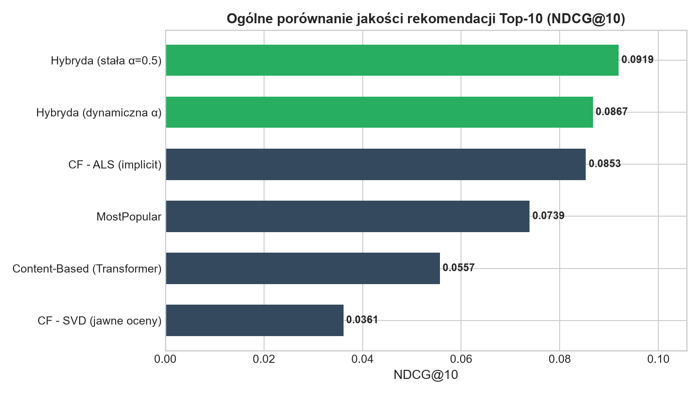
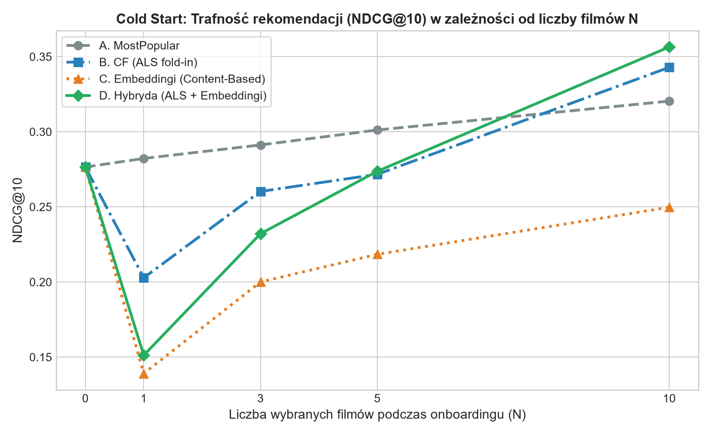
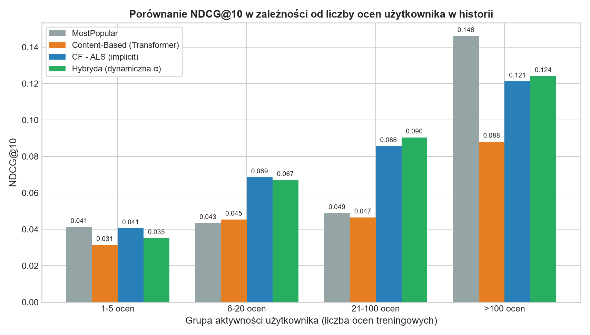

# 🎬 NSI – Hybrydowy System Rekomendacji Filmów (MovieLens 1M + TMDB)

Projekt badawczo-inżynierski realizowany w ramach przedmiotu **Narzędzia Sztucznej Inteligencji (NSI)**.  
System łączy **analizę treści filmów** (embeddingi z modelu **Transformer `all-MiniLM-L6-v2`** na podstawie opisów, słów kluczowych, obsady i reżyserów z **TMDB API**) z **filtrowaniem kolaboratywnym** (**implicit ALS** oraz **jawne SVD**) w model hybrydowy rozwiązujący problem **zimnego startu (*Cold Start*)** oraz generujący wyjaśnienia rekomendacji w języku polskim.

---

## 📌 Główne elementy projektu

1. **Integracja i wzbogacenie danych (`MovieLens 1M` + `TMDB API`):**
   - `1 000 209` ocen wystawionych przez `6 040` użytkowników dla `3 883` filmów (gęstość macierzy: `4,26%`).
   - Automatyczne powiązanie `movieId -> tmdbId` z weryfikacją tytułów i roczników oraz wyszukiwaniem brakujących pozycji w TMDB API (**pokrycie `99,72%`** katalogu, pełne opisy fabuły dla **`99,64%`** filmów).
2. **Ekstrakcja cech (Feature Extraction):**
   - **Content-Based:** Kodowanie złożonego opisu filmu (tytuł, rok, gatunki, reżyser, obsada, słowa kluczowe, opis fabuły) przez sieć **Sentence-BERT (`all-MiniLM-L6-v2`)** do znormalizowanego wektora $\mathbf{e}_i \in \mathbb{R}^{384}$.
   - **Collaborative Filtering:** Faktoryzacja rzadkiej macierzy interakcji do 64-wymiarowych ukrytych wektorów cech użytkowników $\mathbf{p}_u \in \mathbb{R}^{64}$ i filmów $\mathbf{q}_i \in \mathbb{R}^{64}$.
3. **Badane modele i funkcja celu:**
   - `MostPopular`, `BayesianPopular` (średnia ważona bayesowska) oraz `DiversePopular` (dywersyfikacja gatunkowa dla $N=0$).
   - `ContentBasedRecommender` – podobieństwo kosinusowe profilu użytkownika w przestrzeni embeddingów Transformer z priorem rozpoznawalności.
   - `ALSRecommender` – model *implicit feedback* uczony pod ranking Top-10 z analitycznym mechanizmem **fold-in** dla nowych użytkowników bez ponownego trenowania modelu.
   - `SVDRecommender` – faktoryzacja macierzy z biasami na jawnych ocenach 1–5 gwiazdek (do predykcji ocen `RMSE`/`MAE` oraz wyjaśnień).
   - `HybridRecommender` – łączenie wyników ALS i Content-Based wagą zależną od liczby ocen użytkownika:
     $$\text{score}(u, i) = \alpha(n_u)\,\hat{s}_{\text{ALS}}(u, i) + \big(1 - \alpha(n_u)\big)\,\hat{s}_{\text{CB}}(u, i), \qquad \alpha(n_u) = \frac{n_u}{n_u + k}$$
4. **Wyjaśnienia AI po polsku (`src/explanations.py`) i prototyp UI (`app.py`):**
   - Tłumaczenie rekomendacji na podstawie wagi $\alpha(n_u)$, przewidywanej oceny SVD oraz wspólnych faktów z TMDB (reżyser, aktorzy, słowa kluczowe, najbardziej zbliżone filmy z historii).

---

## 📊 Najważniejsze wyniki eksperymentalne

### 1. Ogólne porównanie jakości rekomendacji Top-10


| Model | NDCG@10 | Precision@10 | Recall@10 | Rola / Wniosek |
| :--- | :---: | :---: | :---: | :--- |
| **Hybryda (stała waga $\alpha = 0,5$)** | **0,0919** | **0,0756** | **0,0659** | Najwyższa trafność ogólna na całym zbiorze |
| **Hybryda (dynamiczna waga $\alpha(n)$)** | **0,0867** | **0,0718** | **0,0651** | Płynne przejście od treści do CF wraz z historią |
| **CF – ALS (implicit)** | 0,0853 | 0,0708 | 0,0639 | Najlepszy pojedynczy model rankingowy |
| **MostPopular (punkt odniesienia)** | 0,0739 | 0,0657 | 0,0412 | Silny baseline wynikający z efektu długiego ogona |
| **Content-Based (Transformer)** | 0,0557 | 0,0472 | 0,0368 | Działa od pierwszej oceny i dla filmów bez ocen |
| **CF – SVD (jawne oceny)** | 0,0361 | 0,0339 | 0,0180 | Niski błąd gwiazdkowy (`RMSE = 0,9322`), lecz słaby ranking Top-10 |

### 2. Cold Start (Onboarding: $N \in \{0, 1, 3, 5, 10\}$) i grupy aktywności



Pełny raport z eksploracyjnej analizy danych (EDA) znajduje się w pliku: **[outputs/eda/EDA_raport.md](outputs/eda/EDA_raport.md)**.

---

## 🚀 Instrukcja uruchomienia krok po kroku

### 1. Konfiguracja środowiska
```powershell
py -m venv .venv
.\.venv\Scripts\pip install -r requirements.txt
```

### 2. Pobranie danych MovieLens 1M i wzbogacenie z TMDB API
Skopiuj plik `.env.example` jako `.env` i wpisz swój klucz API z [TMDB](https://www.themoviedb.org/settings/api):
```powershell
Copy-Item .env.example .env
# Uzupełnij TMDB_API_KEY w pliku .env

.\.venv\Scripts\python -m src.download_movielens
.\.venv\Scripts\python -m src.enrich_tmdb
.\.venv\Scripts\python -m src.build_embeddings
```

### 3. Uruchomienie analizy danych (EDA) oraz eksperymentów badawczych
```powershell
.\.venv\Scripts\python -m src.eda_analysis
.\.venv\Scripts\python -m src.run_experiments
```

### 4. Uruchomienie interaktywnego prototypu (Streamlit)
```powershell
.\.venv\Scripts\streamlit run app.py
```

---

## 📂 Struktura repozytorium

```text
NSI-hybrid-movie-recommender/
├── src/
│   ├── download_movielens.py   # Pobieranie MovieLens 1M + ml-latest-small i weryfikacja links.csv
│   ├── enrich_tmdb.py          # Pobieranie opisów, słów kluczowych, obsady i reżyserów z TMDB API
│   ├── build_embeddings.py     # Generowanie 384-wymiarowych embeddingów Transformer (all-MiniLM-L6-v2)
│   ├── eda_analysis.py         # Eksploracyjna analiza danych (cechy, rozkłady, Long Tail)
│   ├── evaluation.py           # Podziały danych oraz metryki NDCG@10, Precision@10, Recall@10, RMSE, MAE
│   ├── models.py               # Implementacja MostPopular, Content-Based, ALS (z fold-in), SVD i Hybrydy
│   ├── explanations.py         # Moduł generowania wyjaśnień rekomendacji po polsku
│   └── run_experiments.py      # Skrypt uruchamiający wszystkie eksperymenty i generujący wykresy
├── outputs/
│   ├── eda/                    # Raport EDA_raport.md, tabele CSV oraz 6 wykresów analizy danych
│   ├── plots/                  # Wykresy wynikowe modeli i eksperymentu Cold Start
│   └── *.csv                   # Tabele wynikowe eksperymentów
├── app.py                      # Interaktywna aplikacja prototypowa (Streamlit)
├── requirements.txt            # Lista zależności Python
├── .env.example                # Szablon konfiguracji klucza TMDB API
└── .gitignore                  # Wykluczenie surowych danych MovieLens (zgodnie z licencją) oraz .env
```

---

## 📜 Licencja i atrybucja danych

1. **MovieLens Dataset:**  
   Zgodnie z licencją GroupLens surowe pliki danych nie są publikowane w repozytorium (są pobierane automatycznie przez skrypt `src/download_movielens.py`).  
   > F. Maxwell Harper and Joseph A. Konstan. 2015. *The MovieLens Datasets: History and Context.* ACM Transactions on Interactive Intelligent Systems (TiiS) 5, 4, Article 19 (December 2015), 19 pages. https://doi.org/10.1145/2827872
2. **The Movie Database (TMDB):**  
   *This product uses the TMDB API but is not endorsed or certified by TMDB.*
