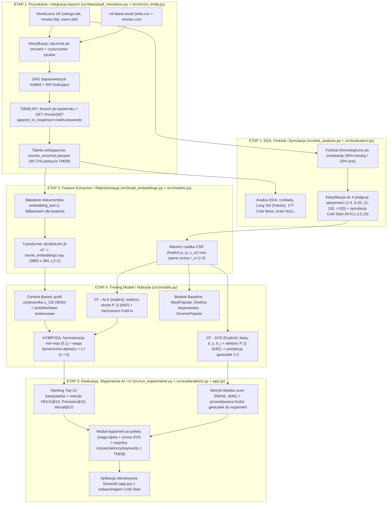

# Kompendium Projektu NSI: Hybrydowy System Rekomendacji Filmów (MovieLens 1M + TMDB)

Dokument zbiera w jednym miejscu kompletne opracowanie teoretyczne i techniczne projektu:
1. **Cechy zbiorów danych (`MovieLens 1M`, `ml-latest-small`, `TMDB API`), wartości `NULL` i anomalie**
2. **Ingerencja w dane i symulacja (dlaczego i jak musimy symulować dane?)**
3. **Algorytm rozwiązywania brakujących połączeń w `links.csv`**
4. **Klasyfikacja użytkowników do podgrup**
5. **Feature Extraction (Ekstrakcja cech)**
6. **Reprezentacja danych, filmów i użytkowników**
7. **Funkcje celu (Objective Functions / Loss Functions)**
8. **Modele Baseline (Punkty odniesienia)**
9. **Autoenkodery (Autoencoders) w systemach rekomendacyjnych i ich związek z projektem**
10. **Pełny Pipeline systemu (Architektura potoku przetwarzania krok po kroku)**

---

## 1. Zbiory danych, ich cechy (atrybuty), wartości `NULL` oraz anomalie

### 1.1. Zbiór główny: MovieLens 1M (`data/raw/ml-1m/`)
Zbiór składa się z 3 plików tekstowych rozdzielanych separatorem `::`:

#### A. Tabela ocen – `ratings.dat` (`1 000 209` wierszy, `0` technicznych wartości `NULL`)
| Cecha | Typ | Zakres / Wartości | Charakterystyka |
| :--- | :--- | :--- | :--- |
| `userId` | `int64` | `1 – 6 040` (`6 040` unikalnych) | Identyfikator użytkownika. Każdy ma w zbiorze co najmniej `20` ocen (`mediana = 96`, `średnia = 165,6`, `maks = 2 314`). |
| `movieId` | `int64` | `1 – 3 952` (`3 706` unikalnych) | Identyfikator ocenionego filmu. |
| `rating` | `int64` | `{1, 2, 3, 4, 5}` | Jawna ocena w gwiazdkach. Średnia: **3,5816 ± 1,1171**, mediana: **4,0**, dominanta: **4** (`34,89%`). Oceny pozytywne ($\ge 4\star$): **57,52%**. |
| `timestamp` | `int64` | `2000-04-25` – `2003-02-28` | Czas w sekundach (Unix epoch) – podstawa chronologicznego podziału trening/test. |

#### B. Tabela użytkowników – `users.dat` (`6 040` wierszy, `0` wartości `NULL`)
| Cecha | Typ | Zakres / Wartości | Charakterystyka |
| :--- | :--- | :--- | :--- |
| `userId` | `int64` | `1 – 6 040` | Klucz główny użytkownika. |
| `gender` | `string` | `'M'`, `'F'` | **Mężczyźni (`M`):** `4 331` (`71,7%`, śr. ocena `3,569`). **Kobiety (`F`):** `1 709` (`28,3%`, śr. ocena `3,620`). |
| `age` | `int64` | `7` kategorii (`1, 18, 25, 35, 45, 50, 56`) | Kod przedziału wiekowego (`1` = `<18`, `18` = `18–24`, `25` = `25–34` [`34,7%`], `35` = `35–44`, `45` = `45–49`, `50` = `50–55`, `56` = `56+`). |
| `occupation` | `int64` | `21` kategorii (`0 – 20`) | Kod zawodu wg słownika GroupLens (m.in. studenci `12,6%`, menedżerowie `11,2%`, naukowcy `8,7%`, inżynierowie `8,3%`, programiści `6,4%`). |
| `zipCode` | `string` | `3 439` unikalnych kodów | Kod pocztowy USA (dane zanonimizowane). |

#### C. Tabela filmów wzbogacona o TMDB – `movies_enriched.parquet` (`3 883` wiersze)
| Cecha | Źródło | Pokrycie | Braki (`NULL` / puste) | Charakterystyka i rola |
| :--- | :--- | :---: | :---: | :--- |
| `movieId`, `title`, `clean_title`, `year` | MovieLens 1M | `3 883` (**100,0%**) | `0` (po naprawie parsera) | Klucz filmu, tytuł oryginalny i oczyszczony, rok premiery (`1919–2000`, mediana `1994`). |
| `tmdbId` | `links.csv` + TMDB Search | `3 872` (**99,72%**) | **`11` (`0,28%`)** | Identyfikator w bazie TMDB (`2 941` z `links.csv` + `931` wyszukanych po tytule i roku). |
| `genres` | MovieLens + TMDB | `3 883` (**100,0%**) | `0` | Połączona lista gatunków (średnio **2,52 gatunku na film**). |
| `overview` | TMDB API | `3 869` (**99,64%**) | **`14` (`0,36%`)** | Angielski opis fabuły (średnio **47,7 słów**, mediana **44 słowa**). |
| `keywords` | TMDB API | `3 583` (**92,27%**) | **`300` (`7,73%`)** | Lista słów kluczowych (średnio **8,77 słów kluczowych** na film). |
| `director` | TMDB API (`crew`) | `3 867` (**99,59%**) | **`16` (`0,41%`)** | Reżyser filmu (do embeddingu i wyjaśnień „ten sam reżyser co...”). |
| `cast` | TMDB API (`cast`) | `3 857` (**99,33%**) | **`26` (`0,67%`)** | Top-5 głównych aktorów (do embeddingu i wyjaśnień). |
| `poster_path` | TMDB API | `3 862` (**99,46%**) | **`21` (`0,54%`)** | Ścieżka do plakatu filmu w interfejsie `Streamlit`. |
| `embedding_text` | Złożone (ML + TMDB) | `3 883` (**100,0%**) | **`0` (`0,00%`)** | Pełny tekst wejściowy dla modelu Transformer (średnio **86,0 słów**). |

### 1.2. Ukryte braki i anomalie w surowym zbiorze MovieLens 1M
1. **Rzadkość macierzy (Sparsity = 95,74%):** W macierzy `użytkownik × film` (`6 040 × 3 883 = 23 453 320` komórek) aż **`22 453 111` komórek jest pustych (`NULL`)** – wypełnione jest tylko **4,26%**.
2. **Filmy bez ani jednej oceny (*Cold Items*):** W katalogu `movies.dat` są `3 883` filmy, ale w `ratings.dat` oceniono tylko `3 706` z nich. Dokładnie **`177` filmów (`4,56%` katalogu) ma `0` ocen** (np. *Guardian Angel (1994)*, *Gospa (1995)*). Dla czystego CF (ALS/SVD) są one całkowicie niewidoczne.
3. **Luki w numeracji `movieId`:** Identyfikatory sięgają od `1` do `3 952`, ale filmów jest `3 883` (`69` numerów ID nie istnieje). Wymaga to stosowania słownika mapującego `id_to_idx` zamiast bezpośredniego indeksowania tablic.
4. **Anomalie w zapisie tytułów:** Rodzajniki przeniesione na koniec (`"Matrix, The (1999)"`), podwójne tytuły obcojęzyczne w nawiasach (`"Confessional, The (Le Confessionnal) (1995)"`) oraz brak spacji przed rokiem w `movieId = 1001` (`"Associate, The (L'Associe)(1982)"`).

### 1.3. Co dokładnie znajduje się w pomocniczym zbiorze `ml-latest-small` (2018)?
Zbiór składa się z 4 plików CSV:
- **`links.csv` (`9 742` wiersze, kolumny: `movieId, imdbId, tmdbId`):** Tabela mapująca `movieId` na klucze zewnętrzne w bazach IMDb i TMDB (posiada `8` pustych wartości `NaN` w kolumnie `tmdbId`).
- **`movies.csv` (`9 742` wiersze, kolumny: `movieId, title, genres`):** Służy w projekcie wyłącznie do weryfikacji, czy tytuł i rok filmu pod danym `movieId` zgadzają się z wersją MovieLens 1M.
- **`ratings.csv` (`100 836` ocen od `610` użytkowników)** oraz **`tags.csv` (`3 683` tagi)** – nieużywane w głównych eksperymentach, które prowadzimy na pełnym zbiorze MovieLens 1M (`1 000 209` ocen).

---

## 2. Ingerencja w dane i symulacja (Dlaczego i jak musimy symulować dane?)

W projekcie **musimy zaingerować w dane w 5 miejscach**, ponieważ surowy zbiór nie pozwalałby bezpośrednio zbadać problemu *Cold Start* ani zbudować modelu hybrydowego:

1. **Symulacja nowych i mało aktywnych użytkowników (ukrywanie historii):**
   - **Dlaczego:** Twórcy MovieLens 1M odfiltrowali wszystkich użytkowników mających mniej niż 20 ocen (`min = 20`). W surowym zbiorze **nie istnieje ani jeden użytkownik** z $0$ ocenami (Cold Start), ani z $1\text{–}5$ czy $6\text{–}19$ ocenami!
   - **Jak symulujemy:**
     - W **eksperymencie Cold Start** losujemy 15% użytkowników (`906` osób), **całkowicie usuwamy ich z treningu CF**, a jako wybór z onboardingu odsłaniamy chronologicznie tylko $N \in \{0, 1, 3, 5, 10\}$ pierwszych filmów ocenionych pozytywnie ($\ge 4\star$).
     - W **badaniu grup aktywności (`1–5` i `6–20` ocen)** wylosowanym podgrupom użytkowników przycinamy historię treningową do pierwszych $1..5$ lub $6..20$ najwcześniejszych ocen.
2. **Wzbogacenie zewnętrzne z TMDB API:** Uzyskanie brakujących opisów fabuły, słów kluczowych, obsady i reżyserów.
3. **Imputacja strukturalna braków tekstowych (`embedding_text`):** Dla `14` filmów bez `overview` i `300` bez `keywords` nie wstawiamy sztucznych napisów `"None"`/`"NaN"` (które zaburzyłyby sieć Transformer), lecz składamy tekst dynamicznie z dostępnych pól (tytuł, rok, gatunki MovieLens, reżyser).
4. **Chronologiczny podział danych (ochrona przed *Data Leakage*):** Sortujemy oceny każdego użytkownika po polu `timestamp` – starsze oceny trafiają do zbioru treningowego, a najnowsze 20% do zbioru testowego.
5. **Binaryzacja i ważenie sygnału dla rankingu Top-10:** Ponieważ ocena `1★` lub `2★` oznacza niezadowolenie z filmu, za trafne rekomendacje (*relevant*) w metrykach `NDCG@10` oraz w macierzy implicit ALS uznajemy wyłącznie oceny pozytywne ($r_{ui} \ge 4$, czyli `57,52%` wszystkich ocen).

---

## 3. Algorytm rozwiązania brakujących połączeń w `links.csv`

Po prostym złączeniu `movies.dat` (3 883 filmy z 2003 r.) z `links.csv` (`ml-latest-small` z 2018 r.) brakowało powiązania dla **`942` filmów (`24,3%`)** (`934` filmów nie było w `ml-latest-small`, `3` miały `tmdbId = NaN`, a `5` odrzucił nasz filtr weryfikacji tytułów/roczników). Rozwiązaliśmy to 4-krokowym potokiem w `src/download_movielens.py` i `src/enrich_tmdb.py`:

1. **Normalizacja tytułów (`parse_title_and_year`):** Wyciągnięcie roku z nawiasu, usunięcie obcojęzycznych tytułów alternatywnych i przestawienie rodzajników z końca na początek (`"Confessional, The (Le Confessionnal) (1995)"` $\to$ `clean_title = "The Confessional"`, `year = 1995`).
2. **Wyszukiwanie w TMDB API z filtrem roku:** Wysłanie zapytania `GET /3/search/movie?query={clean_title}&year={year}&language=en-US`.
3. **Fallback z tolerancją $\pm 2$ lata:** Jeśli sztywny rok premiery w USA różnił się od światowej premiery festiwalowej w TMDB, wyszukiwarka odpytuje sam tytuł i wybiera film o dacie premiery zbliżonej o $\pm 2$ lata (dzięki czemu odnaleźliśmy **931 z 942** brakujących filmów, podnosząc pokrycie do **99,72%**!).
4. **Fallback do metadanych MovieLens:** Dla ostatnich `11` niszowych filmów (`0,28%`) tekst do embeddingu budowany jest z tytułu, roku i gatunków z `movies.dat`.

---

## 4. Klasyfikacja użytkowników do podgrup

### 4.1. Główny podział według aktywności (liczby ocen w historii treningowej $n_u$)
Od przynależności do podgrupy zależy dynamiczna waga $\alpha(n_u) = \frac{n_u}{n_u + 20}$ w modelu hybrydowym:

| Podgrupa aktywności | Warunek ($n_u$) | Liczba użytkowników | Waga CF / ALS ($\alpha$) | Waga treści Transformer ($1-\alpha$) | Dominujący mechanizm |
| :--- | :---: | :---: | :---: | :---: | :--- |
| **0. Zupełnie nowy (Cold Start Etap 1)** | $n_u = 0$ | Symulowani ($N=0$) | `0,0%` | `0,0%` *(100% Baseline)* | `MostPopular` / `DiversePopular` / `Średnia bayesowska` |
| **1. Mało aktywni (`1–5` ocen)** | $1 \le n_u \le 5$ | **906** (`15,0%`) | `4,8% – 20,0%` | **`80,0% – 95,2%`** | Analiza treści (embeddingi Transformer z TMDB) |
| **2. Umiarkowanie aktywni (`6–20` ocen)** | $6 \le n_u \le 20$ | **1 262** (`20,9%`) | `23,1% – 50,0%` | **`50,0% – 76,9%`** | Stopniowe równoważenie treści i ALS (50/50 dla $n_u=20$) |
| **3. Średnio aktywni (`21–100` ocen)** | $21 \le n_u \le 100$ | **2 193** (`36,3%`) | **`51,2% – 83,3%`** | `16,7% – 48,8%` | Przewaga filtrowania kolaboratywnego ALS wspieranego treścią |
| **4. Bardzo aktywni (`>100` ocen)** | $n_u \ge 101$ | **1 679** (`27,8%`) | **`83,5% – 98,9%`** | `1,1% – 16,5%` | Dominacja wzorców współoglądania z modelu ALS |

### 4.2. Podgrupy w eksperymencie Cold Start (Warm vs Cold + progi onboardingu $N$)
- **`Warm Users` (85% = `5 134` użytkowników):** zbiór treningowy do nauki modeli.
- **`Cold Users` (15% = `906` użytkowników):** całkowicie wykluczeni z treningu CF, badani w **5 podgrupach onboardingu**: $N \in \{0, 1, 3, 5, 10\}$ pierwszych pozytywnie ocenionych filmów.

### 4.3. Podgrupy demograficzne (`users.dat`)
- **Płeć:** `M` (`71,7%`), `F` (`28,3%`).
- **Wiek:** 7 przedziałów (`<18`, `18–24`, `25–34`, `35–44`, `45–49`, `50–55`, `56+`).
- **Zawód:** 21 kategorii zawodowych (`0–20`).

---

## 5. Feature Extraction (Ekstrakcja cech)

### 5.1. Ekstrakcja cech treściowych (MovieLens + TMDB $\to$ Transformer $\mathbb{R}^{384}$)
1. **Złożenie dokumentu tekstowego $d_i$:** Połączenie tytułu, roku, gatunków, reżysera, 5 głównych aktorów, 15 słów kluczowych i opisu fabuły `overview` w jeden spójny tekst angielski (średnio 86 słów).
2. **Przetworzenie przez sieć Sentence-BERT (`all-MiniLM-L6-v2`):** Tokenizacja WordPiece $\to$ 6 warstw Transformer $\to$ uśrednienie ukrytych stanów tokenów (*Mean Pooling*) $\to$ normalizacja $L_2$:
   $$\mathbf{e}_i = \frac{\text{MeanPool}(\text{Transformer}(d_i))}{\|\text{MeanPool}(\text{Transformer}(d_i))\|_2} \in \mathbb{R}^{384}, \qquad \|\mathbf{e}_i\|_2 = 1$$
3. **Prior rozpoznawalności filmu $\pi_i \in [0, 1]$:** Znormalizowany logarytm liczby pozytywnych ocen filmu w zbiorze treningowym: $\pi_i = \frac{\ln(1 + c_i^+)}{\max_j \ln(1 + c_j^+)}$.

### 5.2. Ekstrakcja cech ukrytych (Latent Feature Extraction w CF $\to \mathbb{R}^{64}$)
Z rzadkiej macierzy ocen $\mathbf{R}$ o wymiarze $6040 \times 3883$ algorytmy faktoryzacji macierzy (ALS i SVD) wyuczają **64 ukryte cechy behawioralne (*latent factors*)**:
- wektor preferencji użytkownika $\mathbf{p}_u \in \mathbb{R}^{64}$,
- wektor cech ukrytych filmu $\mathbf{q}_i \in \mathbb{R}^{64}$.

---

## 6. Reprezentacja danych, filmów i użytkowników

Każdy obiekt w systemie jest reprezentowany na **4 komplementarnych poziomach**:

| Obiekt | 1. Reprezentacja macierzowa (Interakcje) | 2. Reprezentacja semantyczna (Content-Based) | 3. Reprezentacja behawioralna (CF: ALS / SVD) | 4. Reprezentacja w Hybrydzie i Wyjaśnieniach |
| :--- | :--- | :--- | :--- | :--- |
| **Film $i$** | Kolumna w rzadkiej macierzy CSR ($3883$ kolumn) | Gęsty wektor jednostkowy $\mathbf{e}_i \in \mathbb{R}^{384}$ na sferze $\mathbb{S}^{383}$ | Wektor cech ukrytych $\mathbf{q}_i \in \mathbb{R}^{64}$ (+ bias $b_i \in \mathbb{R}$ w SVD) | Para znormalizowanych ocen $\big(\hat{s}_{\text{CB}}, \hat{s}_{\text{ALS}}\big) \in [0,1]^2$ + słownik faktów TMDB |
| **Użytkownik $u$** | Wiersz w rzadkiej macierzy CSR ($6040$ wierszy) | Ważony środek ciężkości wektorów polubionych filmów: $\mathbf{u}_u^{\text{CB}} = \text{norm}\big(\sum_{i \in \mathcal{I}_u^+} (r_{ui}-2.5)\mathbf{e}_i\big) \in \mathbb{R}^{384}$ | Wektor ukryty $\mathbf{p}_u \in \mathbb{R}^{64}$ (lub wektor *fold-in* $\mathbf{p}_u^{\text{new}} \in \mathbb{R}^{64}$ dla Cold Start) | Liczba ocen $n_u \to$ dynamiczna waga $\alpha(n_u) = \frac{n_u}{n_u + k}$ |
| **Relacja $(u, i)$** | Jawna ocena $r_{ui} \in \{1..5\}$ lub para implicit $(p_{ui}, c_{ui})$ | Podobieństwo kosinusowe $\mathbf{u}_u^{\text{CB}} \cdot \mathbf{e}_i$ | Iloczyn skalarny $\mathbf{p}_u^T \mathbf{q}_i$ | Kombinacja liniowa $\alpha\hat{s}_{\text{ALS}} + (1-\alpha)\hat{s}_{\text{CB}}$ + tekst wyjaśnienia po polsku |

---

## 7. Funkcje celu (Objective Functions / Loss Functions)

### 7.1. Nadrzędna funkcja celu systemu (Ewaluacja i Hybryda)
- **Cel optymalizacji rankingu Top-10:** Maksymalizacja średniego znormalizowanego zdyskontowanego zysku skumulowanego **$\text{NDCG@10}$**:
  $$\max \; \overline{\text{NDCG@10}} = \frac{1}{|U_{\text{test}}|} \sum_{u \in U_{\text{test}}} \frac{\text{DCG@10}(u)}{\text{IDCG@10}(u)}, \qquad \text{gdzie } \text{DCG@10}(u) = \sum_{r=1}^{10} \frac{\mathbb{I}(i_r \in \mathcal{I}_{u,\text{test}}^+)}{\log_2(r + 1)}$$
- **Funkcja scoringowa modelu Hybrydowego:**
  $$S_{\text{Hybryda}}(u, i) = \alpha(n_u) \cdot \hat{s}_{\text{ALS}}(u, i) + \big(1 - \alpha(n_u)\big) \cdot \hat{s}_{\text{CB}}(u, i), \qquad \alpha(n_u) = \frac{n_u}{n_u + k}$$

### 7.2. Funkcje kosztu poszczególnych modeli podczas uczenia
1. **Model ALS (Implicit Matrix Factorization – uczony pod ranking Top-10):**  
   Minimalizuje ważony błąd kwadratowy na **całej tabeli** ($6040 \times 3883$, wliczając nieocenione filmy z wagą $c_{ui}=1$):
   $$\min_{\mathbf{P}, \mathbf{Q}} \; \mathcal{L}_{\text{ALS}} = \sum_{u=1}^{U} \sum_{i=1}^{M} c_{ui} \left( p_{ui} - \mathbf{p}_u^T \mathbf{q}_i \right)^2 + \lambda \left( \sum_{u=1}^{U} \|\mathbf{p}_u\|_2^2 + \sum_{i=1}^{M} \|\mathbf{q}_i\|_2^2 \right)$$
   - Dla nowego użytkownika w Cold Start (*fold-in*) minimalizujemy tę samą funkcję przy zamrożonym $\mathbf{Q}$:
     $$\mathbf{p}_u^{\text{new}} = \left(\mathbf{Q}^T \mathbf{C}_u \mathbf{Q} + \lambda \mathbf{I}\right)^{-1} \mathbf{Q}^T \mathbf{C}_u \mathbf{p}_u$$
2. **Model SVD (Explicit Matrix Factorization – uczony pod predykcję gwiazdek 1–5):**  
   Minimalizuje błąd średniokwadratowy **wyłącznie na znanych ocenach** $(u, i) \in \mathcal{K}$:
   $$\min_{\mathbf{P}, \mathbf{Q}, b_u, b_i} \; \mathcal{L}_{\text{SVD}} = \sum_{(u, i) \in \mathcal{K}} \Big( r_{ui} - (\mu + b_u + b_i + \mathbf{p}_u^T \mathbf{q}_i) \Big)^2 + \lambda \left( \|\mathbf{p}_u\|_2^2 + \|\mathbf{q}_i\|_2^2 + b_u^2 + b_i^2 \right)$$
3. **Model Content-Based (Transformer):**  
   Maksymalizuje podobieństwo kosinusowe $\mathbf{u}_u^{\text{CB}} \cdot \mathbf{e}_i$ skorygowane o prior rozpoznawalności $\pi_i$:
   $$s_{\text{CB}}(u, i) = \max\!\left(0,\, \mathbf{u}_u^{\text{CB}} \cdot \mathbf{e}_i\right) \cdot \left((1 - \beta) + \beta \pi_i^{1.5}\right)$$

---

## 8. Modele Baseline (Punkty odniesienia)

1. **`MostPopular` (`MostPopularRecommender`):** Poleca każdemu najczęściej oceniane filmy, których jeszcze nie widział. Na MovieLens 1M jest bardzo trudnym punktem odniesienia (`NDCG@10 = 0,0739`), ponieważ przez zjawisko **długiego ogona (*Long Tail*)** 20% najpopularniejszych filmów zbiera aż **66,6%** wszystkich ocen. Nie zapewnia jednak żadnej personalizacji i nie wchodzi w skład Hybrydy.
2. **`Średnia bayesowska` (`BayesianPopularRecommender` – Cold Start $N=0$):** Łączy średnią ocenę filmu $R_i$ z liczbą jego ocen $v_i$ oraz średnią globalną $C = 3,58$:
   $$\text{WR}(i) = \frac{v_i}{v_i + m}\, R_i + \frac{m}{v_i + m}\, C \quad (m = 200)$$
   Chroni przed windowaniem na szczyt niszowych filmów z 2 ocenami 5,0.
3. **`Popularne i zróżnicowane gatunkowo` (`DiversePopularRecommender` – Cold Start $N=0$):** Wybiera cyklicznie (*round-robin*) po 1 hicie z 10 głównych gatunków. Utrzymuje wysoką trafność (`NDCG@10 = 0,2718` wobec `0,2765` dla `MostPopular`), eliminując ryzyko zdominowania ekranu startowego przez jeden gatunek (np. samo Sci-Fi).
4. **`Średnia globalna` ($\hat{r}_{ui} = \mu = 3,5816$):** Baseline dla błędu gwiazdkowego (`RMSE = 1,1490`, `MAE = 0,9434`), który nasz model SVD redukuje do **`RMSE = 0,9322`** i **`MAE = 0,7318`**.

---

## 9. Autoenkodery (Autoencoders) w rekomendacjach i ich związek z projektem

### 9.1. Jak działa Autoenkoder rekomendacyjny (`AutoRec`, `CDAE`, `Mult-VAE`)?
Autoenkoder to sieć neuronowa składająca się z trzech części:
1. **Enkoder:** Bierze rzadki wektor historii użytkownika $\mathbf{x}_u \in \mathbb{R}^{3883}$ (gdzie nieobejrzane filmy mają wartość $0$) i kompresuje go do krótkiego wektora w warstwie ukrytej: $\mathbf{z}_u = f(\mathbf{W}_1 \mathbf{x}_u + \mathbf{b}_1) \in \mathbb{R}^{64}$.
2. **Bottleneck (Wąskie gardło $\mathbf{z}_u \in \mathbb{R}^{64}$):** Wymusza na sieci odkrycie ukrytych cech gustu użytkownika zamiast zapamiętywania wejścia na pamięć.
3. **Dekoder:** Odtwarza pełny wektor `3 883` filmów: $\hat{\mathbf{x}}_u = g(\mathbf{W}_2 \mathbf{z}_u + \mathbf{b}_2) \in \mathbb{R}^{3883}$. Wartości, które pojawiają się na miejscach wcześniej zerowych, stanowią **rekomendacje dla nieobejrzanych filmów**.

### 9.2. Związek z naszymi modelami (ALS, SVD, Transformer i Cold Start)
- **ALS i SVD jako Liniowy Autoenkoder:** Bez nieliniowych funkcji aktywacji autoenkoder redukuje się dokładnie do faktoryzacji macierzy ($\hat{\mathbf{R}} = \mathbf{P}\mathbf{Q}^T$), gdzie wektor $\mathbf{p}_u \in \mathbb{R}^{64}$ odpowiada warstwie *Bottleneck* $\mathbf{z}_u$, a macierz filmów $\mathbf{Q}$ odpowiada wagom Dekodera $\mathbf{W}_2$.
- **Mechanizm Fold-in w ALS jako Enkoder:** Równanie analityczne $\mathbf{p}_u^{\text{new}} = (\mathbf{Q}^T \mathbf{C}_u \mathbf{Q} + \lambda \mathbf{I})^{-1} \mathbf{Q}^T \mathbf{C}_u \mathbf{x}_u$ działa identycznie jak **Enkoder** autoenkodera: w jednym kroku przekształca $N$ wybranych w onboardingu filmów w 64-wymiarowy wektor ukryty nowego użytkownika.
- **Denoising Autoencoder a nasza symulacja Cold Start:** W *Denoising Autoencoderach* podczas nauki celowo zakrywa się (zeruje przez *Dropout*) część ocen użytkownika i każe sieci odtworzyć brakującą resztę – to dokładnie ten sam mechanizm, którego użyliśmy przy ukrywaniu historii użytkowników w eksperymentach Cold Start.

---

## 10. Pełny Pipeline systemu (Architektura potoku przetwarzania krok po kroku)

Cały system dzieli się na **Pipeline Offline (przygotowanie danych, ekstrakcja cech, trening i ewaluacja)** oraz **Pipeline Online / Inference (generowanie rekomendacji i wyjaśnień dla użytkownika w czasie rzeczywistym)**.

### Szczegółowy przebieg 6 kroków Pipeline'u w kodzie:

1. **Krok 1 – Ingestia i czyszczenie danych (`src/download_movielens.py`):**
   - Pobiera archiwa `ml-1m.zip` i `ml-latest-small.zip`.
   - Parsuje pliki `.dat`, wyodrębnia czyste tytuły (`clean_title`) i roczniki (`year`), naprawia anomalie formatowania.
   - Łączy `movies.dat` z `links.csv`, weryfikując zgodność tytułów między wersją z 2003 a 2018 roku (odrzuca 5 błędnych powiązań).
   - Zapisuje bazowe pliki `ratings.parquet`, `users.parquet` i `movies_base.parquet`.

2. **Krok 2 – Wzbogacenie zewnętrzne i imputacja (`src/enrich_tmdb.py`):**
   - Dla `942` filmów bez `tmdbId` odpytuje wyszukiwarkę TMDB po tytule i roku (z tolerancją $\pm 2$ lata).
   - Pobiera na 16 wątkach pełne dane (`overview`, `keywords`, `genres`, `cast`, `director`, `poster_path`) z lokalnym cache'em `tmdb_cache.jsonl`.
   - Buduje pole `embedding_text` z warunkową imputacją braków i zapisuje `movies_enriched.parquet`.

3. **Krok 3 – Ekstrakcja embeddingów Transformer (`src/build_embeddings.py`):**
   - Przepuszcza wszystkie `3 883` teksty `embedding_text` przez model `sentence-transformers/all-MiniLM-L6-v2`.
   - Normalizuje wektory do długości jednostkowej ($L_2 = 1$) i zapisuje macierz `movie_embeddings.npy` (`3883 × 384`).

4. **Krok 4 – Eksploracyjna analiza danych, podział i symulacja (`src/eda_analysis.py` + `src/evaluation.py`):**
   - Generuje statystyki opisowe, krzywą długiego ogona (Pareto) i wykresy EDA w `outputs/eda/`.
   - Dzieląc oceny każdego użytkownika chronologicznie po `timestamp` (80% trening / 20% test), klasyfikuje użytkowników do 4 podgrup aktywności (`1–5`, `6–20`, `21–100`, `>100`) oraz przygotowuje podział `Warm/Cold` dla $N \in \{0, 1, 3, 5, 10\}$.

5. **Krok 5 – Uczenie modeli i fuzja hybrydowa (`src/models.py` + `src/run_experiments.py`):**
   - Trenuje modele bazowe (`MostPopular`, `BayesianPopular`, `DiversePopular`), model treściowy (`ContentBasedRecommender`), model jawny (`SVDRecommender` pod RMSE/MAE) oraz model niejawny (`ALSRecommender` pod ranking Top-10).
   - W `HybridRecommender` wylicza dla każdego użytkownika wyniki kandydatów z `ALS` i `Content-Based`, normalizuje je metodą `min-max` do przedziału $[0, 1]$ i łączy wagą $\alpha(n_u) = \frac{n_u}{n_u + k}$.
   - Oblicza metryki `NDCG@10`, `Precision@10`, `Recall@10`, `RMSE` i `MAE` oraz zapisuje tabele i wykresy w `outputs/`.

6. **Krok 6 – Generowanie wyjaśnień i warstwa prezentacji (`src/explanations.py` + `app.py`):**
   - Dla wybranego filmu z Top-10 moduł `RecommendationExplainer` znajduje najbardziej podobne filmy z historii użytkownika, wyznacza część wspólną reżyserów, aktorów i słów kluczowych z TMDB, dołącza wagę $\alpha(n_u)$ oraz przewidywaną ocenę gwiazdkową z SVD i składa wyjaśnienie w języku polskim.
   - Całość jest udostępniona w interaktywnej aplikacji `Streamlit` (`app.py`) z symulatorem onboardingu (30 polaryzujących filmów) i wymaganą atrybucją TMDB.
